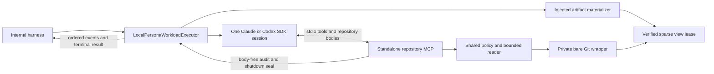

# Repository review workload foundation

This is an internal, unwired Phase 1 foundation. No Persona setting, Workflow dispatch,
artifact capture, database migration, HTTP query service, or Local Inspector behavior is
activated. Existing Workflow execution and the general `LlmRunner` retain their contracts.

## Ownership and data flow

`src/shared/repository-access.ts` owns the strict version 1 contracts. The terminal result
kind is append-only: `persona_verdict` is the sole current member. Later work can append
`inspector_verdict` without replacing the transport. Resolved provider, model and effort live
in `request.execution`; the frozen Persona remains separate. Prompt, daemon-owned images,
call-ledger identity and returned usage survive this boundary. This phase writes no ledger.

`RepositoryArtifactMaterializer` is injected. Phase 2 must verify submission, workload,
attempt, locator and digest against active ownership **before filesystem access**, and return
those identities with a verified descriptor and an immutable, private object directory.
The executor checks the returned identities again. The directory must be detached from the
live repository, contain no filesystem symlinks or external object dependencies, and remain
alive until lease release. This phase supplies fixture materializers only.

The descriptor carries the exact index and worktree manifests/trees, captured HEAD and source
base, and the deterministic all-parent breadth-first history prefix. Limits are 2,048 commits
and 512 MiB of unique allowed historical blob bodies, stopping before overflow. Descriptor
validation checks ordering and omitted-parent boundaries; Phase 2 computes the prefix and
verifies object integrity and byte accounting. Denied bodies may be physically absent. An
unaddressable non-UTF-8 path is never decoded lossily into an addressable path.

For truncated history, the materializer supplies a `shallow` file containing exactly the
frontier commit ids, one per line. Blame checks this boundary before walking. A merge at the
frontier can still have a retained first parent: `git_show` compares that explicit parent,
while blame conservatively stops at the shallow commit. A source base outside retained
history is usable only by the approved layer diffs.

## Repository capabilities and security

The separate `dist/repository-mcp/server.mjs` bundle publishes exactly `read`, `search`,
`glob`, `git_status`, `git_diff`, `git_show`, `git_log`, and `git_blame`. It has no Mission MCP,
HTTP client, bearer token, Registry, or database import. Its launch runs through `env -i`,
receiving only the descriptor path and executable PATH. Provider credentials never enter it.

All operations share canonical POSIX path validation, case-insensitive sensitive segment
policy and Inspector's secret scrubber. Inspector's historical deny grant remains identical.
Symlinks expose only their target blob bytes; submodules are metadata, never traversed.
Binary content is metadata-only in diffs and unavailable as text. Byte reads are refused if
scrubbing would change the immutable bytes. Multiline scrubbing preserves line coordinates.

Git receives closed argv arrays and only descriptor-derived object ids. A disposable bare
wrapper points at the verified object directory without reading its Git configuration.
Global/system config, hooks, external diff/textconv, credential helpers, lazy fetching,
pagers, optional locks and network protocols are disabled. Alternates and grafts are refused.
Blame disables rename following and ignored-revision files, then validates returned paths
and commit membership. Its evidence ranges describe the actual returned lines, including
Git's end-of-file clamping.

Diffs resolve names before reading any body. They return bounded full-file replacement hunks
constructed from explicitly allowed blobs, with separate old/new half-open line intervals.
This intentionally differs from Git's minimal context patches: it avoids executing content
drivers and permits pagination without making a larger unrestricted patch. Each hunk carries
its literal path and modes; binaries and gitlinks carry metadata only. Log path filtering
compares retained parent entries and includes deletions; a boundary remains explicit.

Per-attempt defaults are 128 calls, 32 MiB of serialized successful results and 15 minutes;
per-call defaults are 1 MiB, 100 items and 10 seconds. Blob/command buffering is also bounded
at 1 MiB, so an oversized individual object produces `budget_exhausted`, even for a small
requested window. A result that cannot fit one item fails explicitly. Partial pages carry a
limit and HMAC cursor bound to the snapshot, operation, normalized request and policy. Cursors
cannot cross attempts. Failed, denied, cancelled and omitted items never mint handles.

The reader assigns an unpredictable `evidenceHandleId` to each returned item that has both
an approved repository path and a line, raw-byte, or diff range. For example, a verdict can
cite a text hunk from `git_show` using its operation ID and handle ID. The commit message
from the same query is readable metadata. It has no range or handle and cannot serve
as a repository evidence reference. The same rule applies to metadata-only
items such as `glob` and `git_status` entries, even when they include a path.

Only safe identity, path, range, hashes and counts cross the audit channel. Repository bodies
stay between MCP and provider. The supervisor streams validated audit records and requires a matching shutdown
count/hash seal before accepting success. Audit write failure fails closed. Verdict repository
references must match that attempt's audited operation and handle. Reconciliation replays
cloned, ordered in-memory events; it is not durable Workflow ownership. Cancellation generations
prevent older commands from reviving work, and late verdicts cannot become successful results.

## Provider isolation and the executable gate

The provider reply is an object envelope, `{result: {kind: "persona_verdict", verdict: ...}}`,
with the append-only kind inside it. This satisfies the [structured-output object-root
contract](https://developers.openai.com/api/docs/guides/structured-outputs) while allowing
later result kinds. Null optional fields normalize to absence without changing stored Workflow
schemas. The repository's provider-schema registry tests both rendering and parsing.

The dedicated adapters use the installed Claude Agent SDK and Codex SDK. They start one session
in an empty temporary home and working directory, use native image inputs and structured output,
and close the provider/MCP before releasing the view. They do not widen `LlmRunner`.

Claude has no built-in tools or settings sources, uses strict launch-only MCP configuration,
and permits only the eight repository names. Its initialization inventory is checked.
Codex disables native action features and agents, uses read-only/never-approval settings, and
excludes `functions`, `clock`, and `collaboration` from the Code Mode callable registry.
Code Mode's transport wrappers remain, but their callable registry contains only the eight
repository tools. MCP annotations declare closed, non-destructive reads. A preflight rejects
any extra enabled MCP server.

Native inventories are not a stable SDK API. These adapters therefore fail closed unless the
executable is a verified build: `codex-cli 0.166.0` or `2.1.319 (Claude Code)`. This exact allowlist,
rather than an assumed minimum version, is a deliberate Phase 1 deviation. An upgrade requires
rerunning the executable probe and updating the allowlist after its isolation assertions pass.
There is no prompt-only, direct-file, or repeated-session fallback. Unsupported Claude `xhigh`
effort fails rather than silently changing the resolved execution.

After building the bundle, run `node --import tsx scripts/probe-repository-providers.mjs`.
It uses the real installed SDK/CLI paths against localhost model fixtures, spends no model
tokens, and verifies native images, multiple calls, exact callable inventories, matching line,
raw-byte and diff ranges, terminal results, cancellation and lease release. The source MCP and
reader tests run without provider binaries. `npm run smoke` verifies both built MCP entrypoints.
