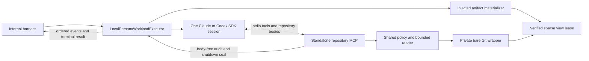

# Repository review workload foundation

Mission Control provides an internal executor, repository MCP and portable checkout artifact
service. Workflow submissions continue to use the existing prompt evidence by default.
Commands and the Inspector gate still pin their existing review commit and publication tree.

## Ownership and data flow

`src/shared/repository-access.ts` owns the strict version 1 contracts. The terminal result
kind is append-only: `persona_verdict` is the sole current member. Later work can append
`inspector_verdict` without replacing the transport. Resolved provider, model and effort live
in `request.execution`; the frozen Persona remains separate. Prompt, daemon-owned images,
call-ledger identity and returned usage survive this boundary. This phase writes no ledger.

`WorkflowRepositoryArtifactService.forRoot` gives the manager and supervisor the same
daemon-owned materializer for a canonical artifact directory. The supervisor can install
or revoke its current workload lookup using `setActiveRequestLookup`. The service checks submission, workload, attempt,
locator and digest, and requires the active SQLite claim and ready artifact before opening
the artifact directory. The executor checks the returned identities again.

## Sealing and retention

`prepare` takes the selected checkout, the Workflow diff's source base and an abort signal.
Each stable-capture attempt samples the exact checkout before reading prompt evidence.
The prepared candidate must match that initial fingerprint and a final live sample.
An index-only edit between the prompt read and preparation therefore discards the
candidate and retries the entire read, even when HEAD, worktree bytes and porcelain
status all stay the same. The default caller leaves the callback absent.

The version 1 directory contains a canonical JSON manifest and flat files named by Git
object id. Each object file holds its Git type and size header followed by its original
bytes. The SHA-256 of the manifest identifies the artifact. Its sorted object table
authenticates every object's type, size, Git id and SHA-256. Original tree bytes preserve
path spelling, mode and gitlink identity. The path table uses hex for raw filename bytes.
Phase 1 can address only canonical UTF-8 paths. A sensitive or unaddressable path keeps
its tree reference and classification while its blob body is omitted. If an allowed and
a denied path share a nonempty blob, capture fails closed. They can share Git's empty
blob, which has zero payload bytes. The sensitive path still denies reads.

Capture reads index entries and Git's nonignored untracked enumeration with optional locks
disabled. It constructs the layer trees from file bytes, literal link targets and gitlinks.
An absent skip-worktree path takes its indexed mode and object ID in the worktree layer.
Files present on disk supply their actual contents, including edits outside a sparse cone.
If a symlink disappears or changes type while its target is being read, stable capture retries.
Status classifications come from comparing the layers. This avoids running repository
filters or textconv to produce status. An unmerged index has no single tree and fails capture.

History starts at HEAD and visits all parents breadth-first in recorded order. The service
stops before the first revision that would exceed 2,048 commits or 512 MiB of additional
unique allowed blob bytes. It counts objects already required by base, HEAD, index or
worktree once, outside the history budget. Missing required objects fail sealing.

`promote` publishes a verified candidate under its digest and attaches a provisional claim
after capture guards pass. `WorkflowStore.commitRepositoryCaptureActivation` makes the
claim active and the submission running in one transaction. Multiple submissions can
independently own the same bytes. Later verification failures block artifact reads while
the submission can still resume or retry. Each lease reconstructs a private loose Git object store
from verified files, along with the layer descriptor used by the MCP. This works after both
the checkout and its Git common directory have disappeared.

Failed capture, submission deletion and evidence retention release claims. The digest row
itself holds cleanup intent and any retryable deletion error. Publication and release commit
their final row states atomically, so neither operation needs a separately committed
intermediate state. Startup releases provisional
claims and reclaims marked pending and lease directories. A publication intent beside the
candidate identifies a rename interrupted before database commit. Periodic maintenance
skips live candidates and leases. Reconciliation inspects existing directories and leaves
unused artifact storage absent. Its failures log `repository_reconcile_failed` independently
of Workflow retention results. Unknown filesystem entries are counted for investigation.
The cleanup transaction rechecks ownership before removing digest files.

For truncated history, the materializer supplies a `shallow` file containing exactly the
frontier commit ids, one per line. Blame checks this boundary before walking. A merge at the
frontier can still have a retained first parent: `git_show` compares that explicit parent,
while blame conservatively stops at the shallow commit. A source base outside retained
history is usable only by the approved layer diffs.

## Repository capabilities and security

The separate `dist/repository-mcp/server.mjs` bundle publishes exactly `read`, `search`,
`glob`, `git_status`, `git_diff`, `git_show`, `git_log`, and `git_blame`. It has no Mission MCP,
HTTP client, bearer token, Registry, or database import. Its launch runs through `env -i`,
receiving only the descriptor path and executable PATH. Provider credentials never enter it.

All operations share canonical POSIX path validation, case-insensitive sensitive segment
policy and Inspector's secret scrubber. Inspector's historical deny grant remains identical.
Symlinks expose only their target blob bytes; submodules are metadata, never traversed.
Binary content is metadata-only in diffs and unavailable as text. Byte reads are refused if
scrubbing would change the immutable bytes. Multiline scrubbing preserves line coordinates.

Git receives closed argv arrays and only descriptor-derived object ids. A disposable bare
wrapper points at the verified object directory without reading its Git configuration.
Global/system config, hooks, external diff/textconv, credential helpers, lazy fetching,
pagers, optional locks and network protocols are disabled. Alternates and grafts are refused.
Blame disables rename following and ignored-revision files, then validates returned paths
and commit membership. Its evidence ranges describe the actual returned lines, including
Git's end-of-file clamping.

Diffs resolve names before reading any body. They return bounded full-file replacement hunks
constructed from explicitly allowed blobs, with separate old/new half-open line intervals.
This intentionally differs from Git's minimal context patches: it avoids executing content
drivers and permits pagination without making a larger unrestricted patch. Each hunk carries
its literal path and modes; binaries and gitlinks carry metadata only. Log path filtering
compares retained parent entries and includes deletions; a boundary remains explicit.

Per-attempt defaults are 128 calls, 32 MiB of serialized successful results and 15 minutes;
per-call defaults are 1 MiB, 100 items and 10 seconds. Blob/command buffering is also bounded
at 1 MiB. A direct read of a larger blob returns `budget_exhausted`, even for a small
requested window. Search skips oversized, binary and invalid UTF-8 blobs. Diffs report
those paths as metadata. A missing allowed blob still fails the query. A result that
cannot fit one item fails explicitly. Partial pages carry a
limit and HMAC cursor bound to the snapshot, operation, normalized request and policy. Cursors
cannot cross attempts. When a call times out after making progress, search resumes at the
interrupted file and line, and log resumes at the interrupted revision. A time-limited
page can have zero matches and a continuation cursor. Failed, denied, cancelled and omitted items never mint handles.
Each admitted call uses one audit slot, including a call cancelled before it reads anything.
Once the call budget is full, queued requests return `budget_exhausted` before admission.

The reader assigns an unpredictable `evidenceHandleId` to each returned item that has both
an approved repository path and a line, raw-byte, or diff range. For example, a verdict can
cite a text hunk from `git_show` using its operation ID and handle ID. The commit message
from the same query is readable metadata. It has no range or handle and cannot serve
as a repository evidence reference. The same rule applies to metadata-only
items such as `glob` and `git_status` entries, even when they include a path.

Only safe identity, path, range, hashes and counts cross the audit channel. Repository bodies
stay between MCP and provider. At shutdown the MCP publishes its complete audit seal by atomic rename.
The supervisor checks its count and hash before accepting success. Audit write failure fails closed.
Verdict repository references must match that attempt's audited operation and handle. The first
dispatch owns the local run. A replay observer can stop or abort its own stream while the owner
continues. Reconciliation returns cloned, ordered in-memory events. Cancellation generations
prevent older commands from reviving work, and late verdicts cannot become successful results.

## Provider isolation and the executable gate

The provider reply is an object envelope, `{result: {kind: "persona_verdict", verdict: ...}}`,
with the append-only kind inside it. This satisfies the [structured-output object-root
contract](https://developers.openai.com/api/docs/guides/structured-outputs) while allowing
later result kinds. Null optional fields normalize to absence without changing stored Workflow
schemas. The repository's provider-schema registry tests both rendering and parsing.

The dedicated adapters use the installed Claude Agent SDK and Codex SDK. They start one session
in an empty temporary home and working directory, use native image inputs and structured output,
and close the provider/MCP before releasing the view. They do not widen `LlmRunner`.

Claude has no built-in tools or settings sources, uses strict launch-only MCP configuration,
and permits only the eight repository names. Its initialization inventory is checked.
Codex disables native action features and agents, uses read-only/never-approval settings, and
excludes `functions`, `clock`, and `collaboration` from the Code Mode callable registry.
Code Mode's transport wrappers remain, but their callable registry contains only the eight
repository tools. MCP annotations declare closed, non-destructive reads. A preflight rejects
any extra enabled MCP server.

Native inventories are not a stable SDK API. These adapters therefore fail closed unless the
executable is a verified build: `codex-cli 0.166.0` or `2.1.319 (Claude Code)`. This exact allowlist,
rather than an assumed minimum version, is a deliberate Phase 1 deviation. An upgrade requires
rerunning the executable probe and updating the allowlist after its isolation assertions pass.
An unsupported build, tool inventory or effort returns `capability_mismatch` with a closed
reason code. Script-based CLI launchers resolve `env node` through a private link to the
configured Node runtime.
There is no prompt-only, direct-file, or repeated-session fallback. Unsupported Claude `xhigh`
effort fails rather than silently changing the resolved execution.

After building the bundle, run `node --import tsx scripts/probe-repository-providers.mjs`.
It uses the real installed SDK/CLI paths against localhost model fixtures, spends no model
tokens, and verifies native images, multiple calls, exact callable inventories, matching line,
raw-byte and diff ranges, terminal results, cancellation and lease release. The source MCP and
reader tests run without provider binaries. `npm run smoke` verifies both built MCP entrypoints.
